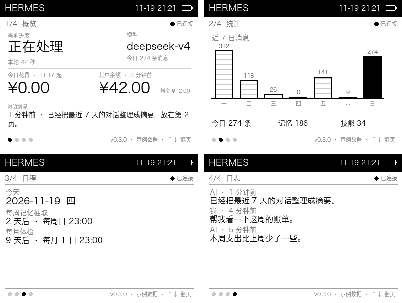
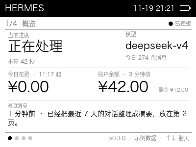

# Personal AI Assistant Status Screen · Zectrix NOTE4

[中文](README.md) | **English**

> A 400×300 always-on card that answers "is my AI working right now, which model is it using,
> what did it cost today, how much balance is left" at a glance. The e-ink panel stays on,
> **↑↓** pages through stats, schedule and recent conversation, and the **confirm** key refreshes
> data. Pages never switch on their own — what refreshes automatically is the data, not the page.





> Screenshots are rendered with sample data and marked "demo" in the footer — not real balances.

## The problem

People who use an AI assistant all day keep checking three things: is it working, what did it cost
today, and is the balance running low. Switching windows or opening a dashboard every time is not
worth it. This screen keeps those numbers in peripheral vision — no glow, no pop-ups, no
interrupting what you are doing.

## How it differs from existing projects

| Existing projects | What they do | This project |
|---|---|---|
| Codex quota boards / Claude Code HUD | Quota and context for **coding sessions** | Daily spend and status for a **general-purpose assistant** |
| Codex pets | Task status + pixel animation | Not tied to any vendor; the data source is swappable |
| AI daily digests / weather / todos | A single kind of content | A runtime portrait of the assistant itself |

The core difference: **it is not an accessory screen for one tool — it is the status screen of *my* AI.**
Change the model, the agent or the provider and it still works.

## The four pages

| Page | Content |
|---|---|
| 1 Overview | Working/idle · model · **spent today** · **balance** (incl. granted credit) · most recent reply (two lines) |
| 2 Stats | Last 7 days bar chart · messages today · memory count · skill count |
| 3 Schedule | Today's date · countdown and a human-readable time description (e.g. "Daily 23:00"; common cron patterns are translated) |
| 4 Log | Last 3 conversation snippets (common Markdown symbols stripped; complex formats such as tables may render literally) |

## Features

- **Real data**: reads the local Hermes state database (message counts, recent conversation), cron
  config, memory store and the DeepSeek balance endpoint. **"Spent today" is computed from the
  day's balance drop** (same basis as the provider dashboard, not a token estimate). The balance
  label shows cache age ("just now", "8 min ago").
- **Non-blocking key handling**: a dedicated coroutine consumes device events continuously. Rapid
  presses are coalesced after a 1.2 s quiet period — the panel takes ~2.5 s to refresh and buffers
  only ~2 presses, so pushing too early drops them.
- **Keeps the frame**: the connection stays open after a push (the stock `show` example calls
  `close()`, which sends the device back to its home screen).
- **Auto reconnect**: retries every 2 s when the device is busy, disconnected, or the lease has not
  been released yet.
- **Single instance**: the render daemon holds a pid lock and exits if started twice, so two
  processes never fight over the device.
- **Adaptive refresh pacing**: 0.5 s after a single press (snappy feedback); 1.2 s after a burst of
  presses so it refreshes once you stop.
- **Log rotation**: daily at 04:00 logs over 1 MB are trimmed to the last 2000 lines
  (`scripts/rotate_logs.sh`).
- **Page count decoupled**: the count travels via `pages.txt`, so changing `PAGE_KEYS` needs no Rust
  changes.
- **Panel-friendly throttling**: paging refreshes immediately; data changes at most once per 5
  minutes; identical content is never redrawn.
- **Battery**: read on connect and every 5 minutes; a 24×11 rounded battery icon in the header fills
  according to charge, with a `!` when ≤20% and not charging.
- **Bilingual UI**: set `"lang": "zh" | "en"` in `config.json` (default Chinese). The English UI uses
  full weekday names to avoid M/T ambiguity.
- **Version marker**: the footer shows the current version so bug reports can be matched to a release.
- **Zero-config trial**: if no local assistant state is found it falls back to sample data (footer
  marked "demo").
- **16-level grayscale**: Chinese renders in Hiragino Sans GB, full 400×300.
- **Font-size workaround**: Hiragino renders the digit `4` as a broken slash glyph at 12/13px, so the
  project avoids those sizes (10/11/14px and up only).

## Architecture

```
 agent_status.py  ──render──▶  status.png  ──watch for changes──▶  watch.rs  ──LAN──▶  NOTE4
   (reads local state)          (atomic replace)        (holds connection + keys)   (screen)
        ▲                                                                             │
        └──────────────── ui_state.txt (page number, same dir as PNG) ◀── ↑/↓ keys ──┘
```

## Install with an AI (recommended)

Give the repository URL to an AI on your computer (Codex / Claude Code / Cursor / Hermes); it reads
the README, installs dependencies, builds and registers the launch agents:

```
Install the GitHub repo JerryLiu720/zectrix-agent-status on this macOS machine:
read the README first; if cmake is missing install it with pip (do not use brew),
if Rust is missing use rustup; after git clone run ./install.sh <device-ip>;
when done confirm the NOTE4 shows page 1.
Troubleshooting: if NoDevice, use a direct IP; if Busy, retry after 2 seconds.
```

## Install time (measured)

Full install on a clean HOME (no Rust, no cargo cache):

| Stage | Time |
|---|---|
| Download Rust toolchain (rsproxy mirror, ~470 MB) | ~10 s |
| Fetch dependencies (Aliyun mirror, 170 MB) | ~10 s |
| Release build (incl. Opus) | ~12 s |
| Self-check + register 3 launch agents | ~2 s |
| **Total** | **~30–40 s** (31.7 s measured on a clean HOME, network dependent) |

If mirrors are unavailable the script falls back to the official sources, which can take minutes to
tens of minutes — it tries Aliyun → rsproxy → tuna in order.

## Manual install (3 steps)

**1. Get the device IP**: on the NOTE4 open **Settings → Network**; you can also look for a
`zectrix-` prefix in your router's DHCP list.
The device must be on the same Wi-Fi and have "keep Wi-Fi in standby" enabled.

**2. Clone**

```bash
git clone https://github.com/JerryLiu720/zectrix-agent-status
cd zectrix-agent-status
```

**3. Run the installer** (replace the IP with yours)

```bash
./install.sh 192.168.1.100
```

`install.sh` installs cmake (via pip, not brew) → fetches the Zectrix SDK (codeload, bypassing
github.com) → builds `watch` → installs three launch agents (render daemon, pusher, log rotation).

For Rust dependencies the script tries **Aliyun → rsproxy → tuna**: it writes the candidate mirror
into `$CARGO_HOME/config.toml` (backing up your original), verifies with `cargo fetch --locked`,
builds, then restores your config. If all fail it falls back to the official source. Set
`ZECTRIX_NO_MIRROR=1` to force the official source.

## Key semantics (important)

The two keys do **different** things:

| Key | Action | Refreshes? |
|---|---|---|
| **↑ / ↓** | Page | **Yes** — paging pushes the new page to the panel; no extra refresh needed |
| **Center confirm** | **Force data refresh** | **Yes** — clears the balance cache, re-fetches, redraws and pushes (~1 s to render + ~2.5 s to appear) |

So:

- **To change page** → press ↑/↓, no need to press confirm
- **Page unchanged but you want fresh data** (balance/spend/progress) → press **confirm**
- You never need to "page in order to refresh"

Refresh cadence: every 60 s during a conversation, every 5 minutes when idle (panel protection),
plus the adaptive key pace (0.5 s single press, 1.2 s after a burst).

## Usage

| Action | Effect |
|---|---|
| Short press ↑ / ↓ | Previous / next page |
| Long press ↑ / ↓ | No action (long presses emit `Long` events; disabled to avoid accidental jumps) |
| Short or long press confirm | **Force refresh**: clear balance cache, re-render and push (~1 s) |
| Edit `PAGE_KEYS` in `agent_status.py` | Add/remove pages |

Manual debugging:

```bash
python3 agent_status.py --page 1          # render only page 2 into status.png
python3 agent_status.py --selftest        # render all pages and check dimensions
python3 agent_status.py --demo            # render with sample data
python3 tests/test_wrap.py                # regression tests for wrapping/cleaning
python3 scripts/make_screenshots.py       # regenerate README screenshots (page0-3 + preview + demo.gif)
~/zectrix-agent-status/bin/zectrix-watch <IP> status.png gray16
```

## UI language (Chinese / English)

The default is Chinese. For an English UI, edit `config.json` (copy it from `config.example.json` if missing):

```json
{
  "source": "hermes",
  "assistant_name": "HERMES",
  "lang": "en"
}
```

Then restart the renderer:

```bash
./restart.sh
```

Set `"lang": "zh"` to switch back. The English UI covers every label, time format and weekday name on
all four pages. `config.json` changes need a restart; `stats_file` reloads automatically on mtime.

## Plug in another assistant (config only, no code changes)

Copy `config.example.json` to `config.json`:

| Field | Values | Meaning |
|---|---|---|
| `source` | `hermes` / `json` | `hermes` = read local Hermes data; `json` = read a stats file written by any assistant |
| `assistant_name` | string | Name shown in the header, default `HERMES` |
| `stats_file` | path | File read when `source=json` (supports `~`) |
| `lang` | `zh` / `en` | UI language, default `zh` |

With `source=json`, **any assistant** (Codex, Claude Code, a custom bot…) just writes a JSON file
periodically; the schema is in `stats.example.json`:

| Field | Meaning |
|---|---|
| `model` | Current model name |
| `balance` / `granted` | Account balance / granted credit |
| `spend_today` | Spent today |
| `messages_today` | Messages today |
| `memory_count` / `skill_count` | Memory entries / skills |
| `week` | Messages per day for the last 7 days (7 integers) |
| `cron` | `[{name, next, schedule}]` scheduled jobs |
| `active` / `elapsed` | Working? / seconds elapsed in this turn |
| `battery` / `charging` | Device battery etc. (optional; normally written by watch) |
| `last_reply` / `recent` | `{role, content, ts}` latest reply / latest messages |

The file is reloaded automatically when it changes (by mtime); no restart needed.

## Stop / start / uninstall

The scripts only manage **processes** and the **device connection**. Whether to auto-start at login
is controlled by **System Settings → General → Login Items**.

| Goal | Command | Result |
|---|---|---|
| Disconnect the panel (stay logged in) | `./scripts/zectrix pause` | Disconnects the device; asks in a terminal whether to also stop processes |
| Disconnect and stop (for AI) | `./scripts/zectrix off` | Disconnects + ends processes |
| Stop processes only | `./scripts/stop.sh` | Ends processes; device returns to home |
| Turn back on | `./scripts/start.sh` | Starts and connects the device |
| Restart after code changes | `./restart.sh` | Restarts the render daemon and pusher |
| Status | `./scripts/zectrix status` | Panel / processes / heartbeat / recent log |
| Uninstall | `./scripts/uninstall.sh` | Stops and removes the launch agents |

`stop.sh` does not touch login items; whether it auto-starts next login depends on the system setting.

## FAQ

| Symptom | Cause / fix |
|---|---|
| `Error: NoDevice` | The SDK's mDNS discovery is unreliable; **pass the IP directly** |
| `Error: Busy` | Another connection holds the device; wait 2 s (this project retries automatically) |
| Chinese renders as boxes | Pillow on this machine cannot open `PingFang.ttc`; the project uses `Hiragino Sans GB`. Digits at 12/13px are broken, so 10/11/14px are used |
| Keys do nothing | The page-number file must be in the **same directory as the PNG**; built in since this version |
| Screen returns to home | The device goes home when the pusher exits; install as launch agents via `install.sh` to keep it alive |
| Edited `agent_status.py` but the panel is unchanged | Python does not hot-reload; restart the daemon with `./restart.sh` |
| Rapid presses page only once | Adaptive quiet period: 0.5 s for a single press, 1.2 s after a burst |

## Known limitations

- LAN only (LAN v1 protocol, port 32342)
- One client per device at a time
- A panel refresh takes ~2.5 s; presses during a refresh are buffered by the device (~2), so bursts are coalesced
- **The computer must stay awake**: rendering and pushing happen locally; if it sleeps or shuts down the panel keeps the last frame
- The English UI (`lang: en`) covers all labels and time formats on the four pages; cron expressions are translated only for common patterns (daily / weekly / monthly / weekdays / every N minutes / every N hours) and shown as-is otherwise
- Verified only on Apple Silicon macOS; Windows / Linux untested

## License

MIT. The SDK and protocol come from the [Zectrix local push SDK](https://github.com/itopinion/zectrix-local-push-sdk), under its MIT license.

---

- **Source**: https://github.com/JerryLiu720/zectrix-agent-status
- **Community page**: https://zectrix.com/developer/projects/zectrix-agent-status.html
