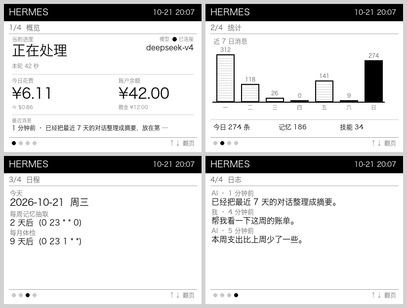

# 个人 AI 助手状态屏 · Zectrix NOTE4

> 别人做的是「Codex / Claude Code 编程助手」的看板；这一版做的是**任何个人 AI 助手**的桌面副屏：
> 现在在不在干活、用的什么模型、今天花了多少钱、账户还剩多少、今天聊了多少、下一步定时任务是什么。



## 和社区现有项目的区别

| 现有项目 | 它们做的 | 这个项目 |
|---|---|---|
| Codex 配额看板 / Claude Code HUD | **编程会话**的额度与上下文 | **通用个人助手**的日常开销与状态 |
| Codex 宠物 | 任务状态 + 像素动画 | 不绑定任何一家 agent，数据源可换 |
| AI 日报 / 天气 / 待办 | 单一内容 | 助手自身的运行画像 |

核心差异：**它不是某个工具的附属屏，而是"我的 AI"的状态屏** —— 换模型、换 agent、换供应商都能用。

## 四页内容

| 页 | 内容 |
|---|---|
| 1 概览 | 运行中/空闲 · 模型 · **今日花费** · **账户余额**（含赠金） |
| 2 统计 | 近 7 日消息柱状图 · 今日条数 · 记忆条数 · 技能个数 |
| 3 日程 | 今天日期 · 所有定时任务的倒计时与 cron 表达式 |
| 4 日志 | 最近 3 条对话摘要（自动去掉 Markdown 符号） |

## 特性

- **真实数据**：读 Hermes 本地状态库（消息量、token 与花费）、cron 配置、记忆库、DeepSeek 余额接口
- **按键翻页**：短按 ↑/↓ 切页；短按确认 = 立即重推当前页
- **保持画面**：推完不关闭连接（官方 `show` 示例会 `close()`，设备立刻回主页）
- **自动重连**：设备被占用 / 断线 / 租约未释放时每 2 秒重试
- **护屏节流**：翻页立即刷新；数据类变化 5 分钟最多一次；内容不变绝不重绘
- **十六灰阶**：中文用 Hiragino Sans GB 渲染，400×300 满屏

## 架构

```
 agent_status.py  ──渲染──▶  status.png  ──监视变化──▶  watch.rs  ──LAN──▶  NOTE4
   （读本地状态）              （原子替换）        （保持连接 + 按键）      （屏幕）
        ▲                                                                    │
        └──────────────── ui_state.txt（页码，与 PNG 同目录）◀── 按键 ↑/↓ ──┘
```

## 用 AI 安装（推荐）

把仓库地址交给电脑上的 AI（Codex / Claude Code / Cursor / Hermes），它会读 README、装依赖、编译并注册开机自启：

```
帮我在这台 macOS 上安装 GitHub 仓库 JerryLiu720/zectrix-agent-status：
先读 README，缺 cmake 用 pip 装（不要用 brew），缺 Rust 用 rustup；
git clone 后执行 ./install.sh <设备IP>；完成后确认 NOTE4 显示第 1 页。
排错：NoDevice 改用 IP 直连；Busy 等 2 秒自动重试。
```

## 安装（手动 3 步）

```bash
./install.sh 192.168.1.100      # 设备需与电脑同一 Wi-Fi，并开启「待机保持 Wi-Fi」
```

`install.sh` 会：装 cmake（pip，不走 brew）→ 拉取 Zectrix SDK（codeload 绕过 github.com）→ 编译 `watch` → 安装两个 LaunchAgent（渲染 daemon + 设备推送）。

## 使用

| 操作 | 效果 |
|---|---|
| 短按 ↑ / ↓ | 上一页 / 下一页 |
| 短按确认 | 立即重推当前页 |
| 改 `agent_status.py` 的 `PAGES` | 增删页面 |

手动调试：

```bash
python3 agent_status.py --page 1          # 只渲染第 2 页到 status.png
cargo run --example watch -- <IP> status.png gray16
```

## 换成你自己的助手

数据都从这几个地方读，替换即可：

| 数据 | 来源 |
|---|---|
| 消息量 / 花费 | `~/.hermes/state.db` → `messages`、`session_model_usage` |
| 定时任务 | `~/.hermes/cron/jobs.json` |
| 记忆 / 技能 | `~/.hermes/memory_store.db`、`~/.hermes/skills/**/SKILL.md` |
| 余额 | DeepSeek `/user/balance`（缓存 10 分钟） |

换别的 agent，只要把 `week_counts()` / `today_cost()` / `cron_jobs()` 换掉即可，渲染层不用动。

## 常见问题

| 现象 | 原因 / 解法 |
|---|---|
| `Error: NoDevice` | SDK 的 mDNS 自动发现不稳；**直接传 IP** |
| `Error: Busy` | 设备被上一个连接占着，等 2 秒（本项目会自动重试） |
| 中文显示成方块 | 本机 Pillow 打不开 `PingFang.ttc`，已改用 `Hiragino Sans GB` |
| 按键没反应 | 页码文件必须与 PNG **同目录**；本版已内置，勿改路径 |
| 屏幕回主页 | 推送进程退出后设备会回主页；用 install.sh 装成 LaunchAgent 可常驻 |
| 改了 `agent_status.py` 但屏幕没变 | Python 不热加载，必须重启 daemon：`./restart.sh` |

## 已知限制

- 仅同一局域网（LAN v1 协议，端口 32342）
- 同一设备同时只能有一个客户端连接
- 花费为 token 估算值（DeepSeek 计价），非账单金额

## License

MIT。SDK 与协议来自 [Zectrix 本地推送 SDK](https://github.com/itopinion/zectrix-local-push-sdk)，遵循其 MIT 许可。


---

**源码地址**：https://github.com/JerryLiu720/zectrix-agent-status
